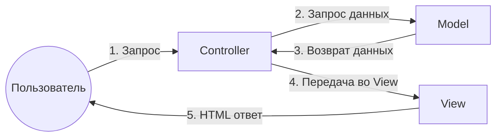
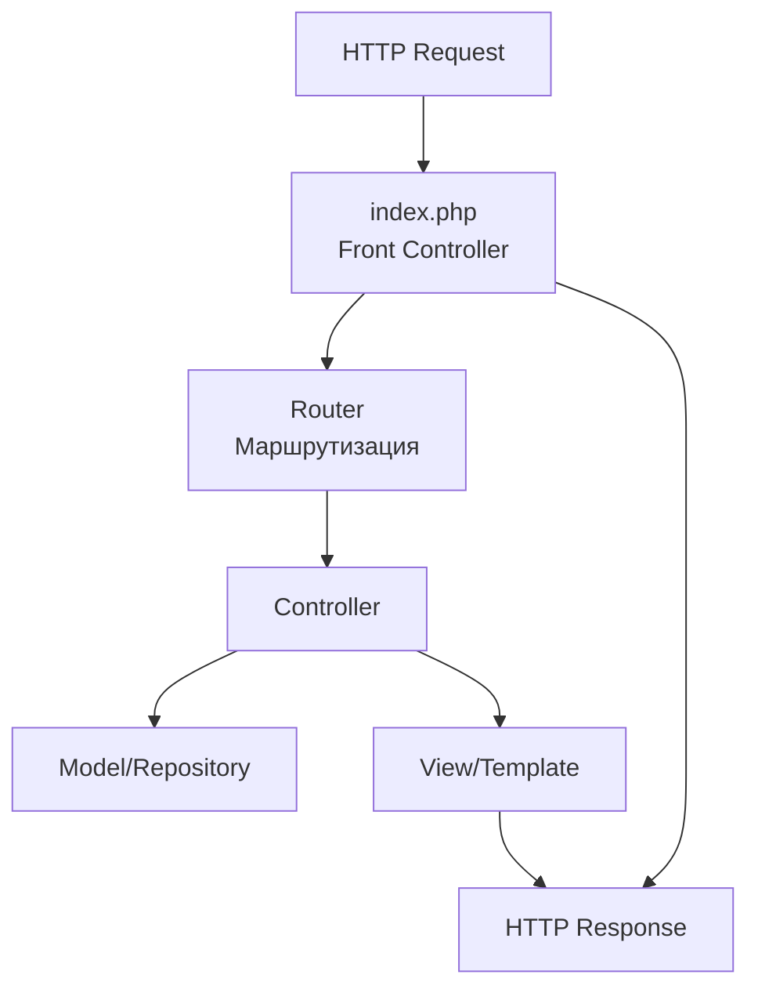
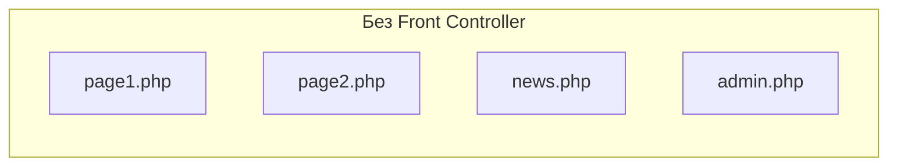
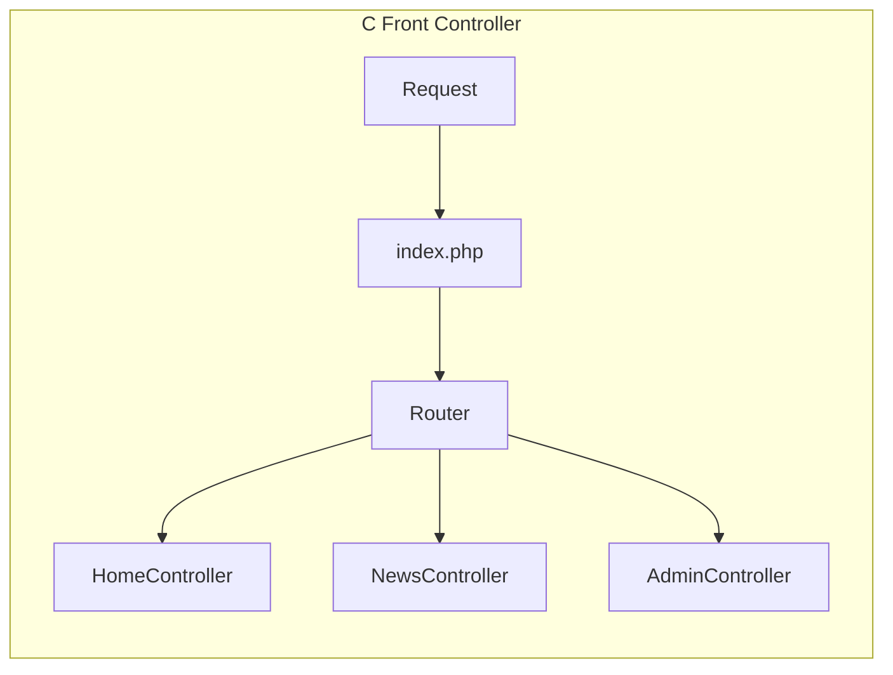
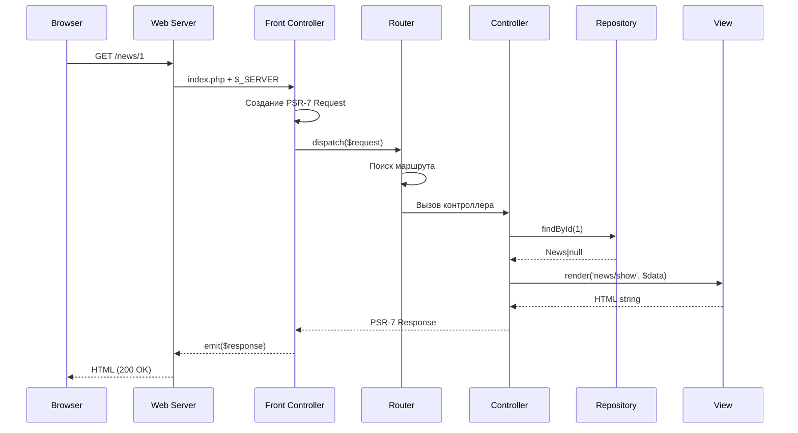
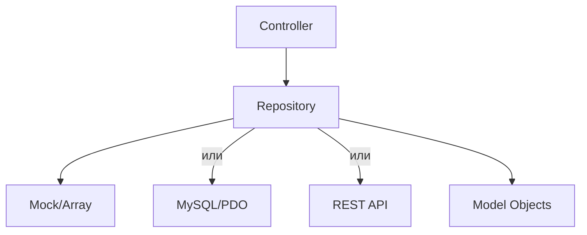
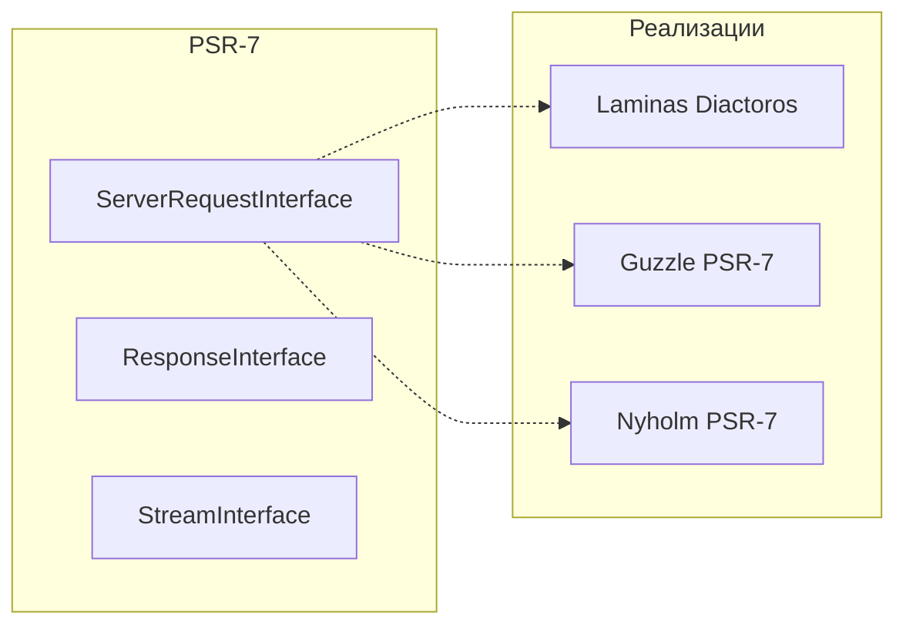
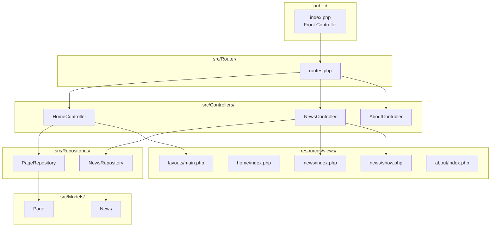

# Практическое задание: MVC в PHP 8.3+

## 📚 Часть 1: Теория (20-30 минут)

### 1.1 Паттерн MVC (Model-View-Controller)

**MVC** — архитектурный паттерн, разделяющий приложение на три компонента:

| Компонент | Ответственность |
|-----------|----------------|
| **Model** | Данные и бизнес-логика |
| **View** | Отображение данных (UI) |
| **Controller** | Обработка запросов, связь Model и View |



**Преимущества MVC:**
- Разделение ответственности (SoC)
- Переиспользование моделей
- Тестируемость компонентов
- Масштабируемость

### 1.2 Front Controller

**Front Controller** — паттерн, при котором все запросы проходят через единую точку входа (обычно `index.php`).



**Проблема без Front Controller:**


**Решение с Front Controller:**


### 1.3 Полный жизненный цикл запроса



### 1.4 Паттерн Repository

Repository абстрагирует работу с данными, предоставляя коллекционный интерфейс:



**Зачем Repository?**
- Контроллер не знает источник данных
- Легко заменить реализацию (mock → DB)
- Централизация бизнес-правил доступа к данным

### 1.5 PSR-7 и современные HTTP

**PSR-7 (HTTP Message Interface)** — стандарт описания HTTP-сообщений:
- `ServerRequestInterface` — входящий запрос
- `ResponseInterface` — исходящий ответ
- `StreamInterface` — тело сообщения



### 1.6 Итоговая архитектура проекта



---

## 🛠️ Часть 2: Реализация MVC + Front Controller

### 2.1 Структура проекта

```
mvc-site/
├── public/
│   ├── index.php          # Front Controller (точка входа)
│   └── css/
├── src/
│   ├── Controllers/
│   │   ├── HomeController.php
│   │   ├── NewsController.php
│   │   └── AboutController.php
│   ├── Models/
│   │   └── News.php
│   ├── Repositories/
│   │   ├── NewsRepositoryInterface.php
│   │   └── MockNewsRepository.php
│   ├── Services/
│   │   └── ViewRenderer.php
│   └── Router/
│       └── routes.php
├── resources/
│   └── views/
│       ├── layouts/
│       │   └── main.php
│       ├── home/
│       │   └── index.php
│       ├── news/
│       │   ├── index.php
│       │   └── show.php
│       └── about/
│           └── index.php
├── composer.json
└── .htaccess
```

### 2.2 Установка зависимостей

**composer.json:**
```json
{
    "name": "site/mvc-card",
    "description": "Сайт-визитка с новостями на MVC",
    "type": "project",
    "require": {
        "php": ">=8.3",
        "league/route": "^7.0",
        "laminas/laminas-diactoros": "^3.5",
        "laminas/laminas-httphandlerrunner": "^2.10"
    },
    "autoload": {
        "psr-4": {
            "App\\": "src/"
        }
    }
}
```

**Установка:**
```bash
composer require league/route laminas/laminas-diactoros laminas/laminas-httphandlerrunner
```

### 2.3 Модель (Model)

**src/Models/News.php:**
```php
<?php

declare(strict_types=1);

namespace App\Models;

final readonly class News
{
    public function __construct(
        public int $id,
        public string $title,
        public string $slug,
        public string $content,
        public string $summary,
        public \DateTimeImmutable $publishedAt,
        public string $imageUrl = '',
    ) {}
}
```

### 2.4 Repository

**src/Repositories/NewsRepositoryInterface.php:**
```php
<?php

declare(strict_types=1);

namespace App\Repositories;

use App\Models\News;

interface NewsRepositoryInterface
{
    /**
     * @return News[]
     */
    public function findAll(): array;
    
    public function findById(int $id): ?News;
    
    public function findBySlug(string $slug): ?News;
    
    /**
     * @return News[]
     */
    public function findLatest(int $limit = 5): array;
    
    public function count(): int;
}
```

**src/Repositories/MockNewsRepository.php:**
```php
<?php

declare(strict_types=1);

namespace App\Repositories;

use App\Models\News;

final class MockNewsRepository implements NewsRepositoryInterface
{
    /** @var News[] */
    private array $items;
    
    public function __construct()
    {
        $this->items = [
            new News(
                id: 1,
                title: 'Запуск нового сайта',
                slug: 'launch-new-site',
                content: 'Мы рады представить наш обновлённый сайт-визитку! На нём вы найдёте актуальную информацию о нашей компании, последних новостях и проектах. Мы постарались сделать интерфейс максимально удобным и информативным.',
                summary: 'Мы рады представить наш обновлённый сайт-визитку!',
                publishedAt: new \DateTimeImmutable('2026-10-28'),
                imageUrl: 'https://picsum.photos/seed/news1/800/400',
            ),
            new News(
                id: 2,
                title: 'Новые услуги для клиентов',
                slug: 'new-services',
                content: 'С этого месяца мы предлагаем расширенный пакет услуг для наших постоянных клиентов. В него входят: бесплатные консультации, приоритетная поддержка и скидки на все новые продукты.',
                summary: 'Расширенный пакет услуг для постоянных клиентов.',
                publishedAt: new \DateTimeImmutable('2026-10-25'),
                imageUrl: 'https://picsum.photos/seed/news2/800/400',
            ),
            new News(
                id: 3,
                title: 'Участие в IT-конференции 2026',
                slug: 'it-conference-2026',
                content: 'Наша команда приняла участие в крупнейшей IT-конференции года. Мы поделились опытом разработки современных веб-приложений, обсудили тренды в индустрии и завели полезные знакомства.',
                summary: 'Наша команда на крупнейшей IT-конференции года.',
                publishedAt: new \DateTimeImmutable('2026-10-20'),
                imageUrl: 'https://picsum.photos/seed/news3/800/400',
            ),
            new News(
                id: 4,
                title: 'Обновление серверной инфраструктуры',
                slug: 'server-update',
                content: 'Мы обновили серверную инфраструктуру до PHP 8.3 и настроили современные инструменты разработки. Это позволило повысить производительность сайта на 40% и улучшить безопасность.',
                summary: 'Переход на PHP 8.3 и обновление инфраструктуры.',
                publishedAt: new \DateTimeImmutable('2026-10-15'),
                imageUrl: 'https://picsum.photos/seed/news4/800/400',
            ),
            new News(
                id: 5,
                title: 'Открытие нового офиса',
                slug: 'new-office',
                content: 'Мы рады сообщить об открытии нового офиса в центре города. Теперь нашим клиентам ещё удобнее добираться до нас. Приглашаем на экскурсию и знакомство с командой!',
                summary: 'Новый офис в центре города открыт для клиентов.',
                publishedAt: new \DateTimeImmutable('2026-10-10'),
                imageUrl: 'https://picsum.photos/seed/news5/800/400',
            ),
        ];
    }
    
    public function findAll(): array
    {
        return $this->items;
    }
    
    public function findById(int $id): ?News
    {
        foreach ($this->items as $item) {
            if ($item->id === $id) {
                return $item;
            }
        }
        return null;
    }
    
    public function findBySlug(string $slug): ?News
    {
        foreach ($this->items as $item) {
            if ($item->slug === $slug) {
                return $item;
            }
        }
        return null;
    }
    
    public function findLatest(int $limit = 5): array
    {
        usort($this->items, fn(News $a, News $b) => $b->publishedAt <=> $a->publishedAt);
        return array_slice($this->items, 0, $limit);
    }
    
    public function count(): int
    {
        return count($this->items);
    }
}
```

### 2.5 Сервис рендеринга представлений

**src/Services/ViewRenderer.php:**
```php
<?php

declare(strict_types=1);

namespace App\Services;

final class ViewRenderer
{
    private string $viewsPath;
    
    public function __construct(string $viewsPath)
    {
        $this->viewsPath = rtrim($viewsPath, '/');
    }
    
    /**
     * @param array<string, mixed> $data
     */
    public function render(string $view, array $data = []): string
    {
        $content = $this->renderPartial($view, $data);
        
        return $this->renderPartial('layouts/main', [
            'content' => $content,
            'title' => $data['title'] ?? 'Сайт-визитка',
        ]);
    }
    
    /**
     * @param array<string, mixed> $data
     */
    public function renderPartial(string $view, array $data = []): string
    {
        $file = $this->viewsPath . '/' . $view . '.php';
        
        if (!file_exists($file)) {
            throw new \RuntimeException("View not found: {$view}");
        }
        
        extract($data, EXTR_SKIP);
        
        ob_start();
        include $file;
        return ob_get_clean();
    }
}
```

### 2.6 Контроллеры

**Базовый контроллер** (src/Controllers/AbstractController.php):
```php
<?php

declare(strict_types=1);

namespace App\Controllers;

use App\Services\ViewRenderer;
use Laminas\Diactoros\Response\HtmlResponse;
use Psr\Http\Message\ResponseInterface;

abstract class AbstractController
{
    public function __construct(
        protected readonly ViewRenderer $view,
    ) {}
    
    protected function render(string $view, array $data = [], int $status = 200): ResponseInterface
    {
        $html = $this->view->render($view, $data);
        return new HtmlResponse($html, $status);
    }
    
    protected function notFound(string $message = 'Страница не найдена'): ResponseInterface
    {
        return $this->render('errors/404', ['message' => $message], 404);
    }
}
```

**src/Controllers/HomeController.php:**
```php
<?php

declare(strict_types=1);

namespace App\Controllers;

use App\Repositories\NewsRepositoryInterface;
use Psr\Http\Message\ResponseInterface;
use Psr\Http\Message\ServerRequestInterface;

final class HomeController extends AbstractController
{
    public function __construct(
        ViewRenderer $view,
        private readonly NewsRepositoryInterface $newsRepository,
    ) {
        parent::__construct($view);
    }
    
    public function index(ServerRequestInterface $request): ResponseInterface
    {
        $latestNews = $this->newsRepository->findLatest(3);
        
        return $this->render('home/index', [
            'title' => 'Главная — Сайт-визитка',
            'latestNews' => $latestNews,
        ]);
    }
}
```

**src/Controllers/NewsController.php:**
```php
<?php

declare(strict_types=1);

namespace App\Controllers;

use App\Repositories\NewsRepositoryInterface;
use Psr\Http\Message\ResponseInterface;
use Psr\Http\Message\ServerRequestInterface;

final class NewsController extends AbstractController
{
    public function __construct(
        ViewRenderer $view,
        private readonly NewsRepositoryInterface $newsRepository,
    ) {
        parent::__construct($view);
    }
    
    public function index(ServerRequestInterface $request): ResponseInterface
    {
        $news = $this->newsRepository->findAll();
        
        return $this->render('news/index', [
            'title' => 'Новости — Сайт-визитка',
            'news' => $news,
        ]);
    }
    
    public function show(ServerRequestInterface $request, array $args): ResponseInterface
    {
        $slug = $args['slug'] ?? '';
        $newsItem = $this->newsRepository->findBySlug($slug);
        
        if ($newsItem === null) {
            return $this->notFound('Новость не найдена');
        }
        
        return $this->render('news/show', [
            'title' => $newsItem->title . ' — Сайт-визитка',
            'news' => $newsItem,
        ]);
    }
}
```

**src/Controllers/AboutController.php:**
```php
<?php

declare(strict_types=1);

namespace App\Controllers;

use Psr\Http\Message\ResponseInterface;
use Psr\Http\Message\ServerRequestInterface;

final class AboutController extends AbstractController
{
    public function index(ServerRequestInterface $request): ResponseInterface
    {
        return $this->render('about/index', [
            'title' => 'О компании — Сайт-визитка',
        ]);
    }
}
```

### 2.7 Маршрутизация (Router)

**src/Router/routes.php:**
```php
<?php

declare(strict_types=1);

use App\Controllers\AboutController;
use App\Controllers\HomeController;
use App\Controllers\NewsController;
use League\Route\Router;

return function (Router $router): void {
    $router->get('/', [HomeController::class, 'index'])->setName('home');
    $router->get('/about', [AboutController::class, 'index'])->setName('about');
    $router->get('/news', [NewsController::class, 'index'])->setName('news.index');
    $router->get('/news/{slug}', [NewsController::class, 'show'])->setName('news.show');
};
```

### 2.8 Front Controller

**public/index.php:**
```php
<?php

declare(strict_types=1);

use App\Controllers\AboutController;
use App\Controllers\HomeController;
use App\Controllers\NewsController;
use App\Repositories\MockNewsRepository;
use App\Repositories\NewsRepositoryInterface;
use App\Services\ViewRenderer;
use Laminas\Diactoros\ServerRequestFactory;
use Laminas\HttpHandlerRunner\Emitter\SapiEmitter;
use League\Route\Router;
use League\Route\Strategy\ApplicationStrategy;

require_once __DIR__ . '/../vendor/autoload.php';

// ─── Bootstrap ───────────────────────────────────────────────────────
$basePath = dirname(__DIR__);
$viewsPath = $basePath . '/resources/views';

// Создание сервисов (без PSR-11 контейнера — ручная сборка)
$viewRenderer = new ViewRenderer($viewsPath);
$newsRepository = new MockNewsRepository();

// Создание контроллеров с передачей зависимостей
$homeController = new HomeController($viewRenderer, $newsRepository);
$newsController = new NewsController($viewRenderer, $newsRepository);
$aboutController = new AboutController($viewRenderer);

// Маппинг контроллеров: class => instance
$controllerMap = [
    HomeController::class => $homeController,
    NewsController::class => $newsController,
    AboutController::class => $aboutController,
];

// ─── HTTP Request (PSR-7) ───────────────────────────────────────────
$request = ServerRequestFactory::fromGlobals(
    $_SERVER,
    $_GET,
    $_POST,
    $_COOKIE,
    $_FILES,
);

// ─── Router setup ───────────────────────────────────────────────────
$router = new Router();
$router->setStrategy(new ApplicationStrategy());

// Загрузка маршрутов
$routesLoader = require $basePath . '/src/Router/routes.php';
$routesLoader($router);

// ─── Dispatch ───────────────────────────────────────────────────────
try {
    $response = $router->dispatch($request);
} catch (\League\Route\Http\Exception\NotFoundException $e) {
    // Простая обработка 404
    $response = new \Laminas\Diactoros\Response\HtmlResponse(
        '<h1>404 — Страница не найдена</h1><p><a href="/">На главную</a></p>',
        404,
    );
} catch (\Throwable $e) {
    // Логируем ошибку (в production — в файл/сервис)
    error_log((string) $e);
    
    $response = new \Laminas\Diactoros\Response\HtmlResponse(
        '<h1>500 — Внутренняя ошибка сервера</h1>',
        500,
    );
}

// ─── Send response ──────────────────────────────────────────────────
(new SapiEmitter())->emit($response);
```

> ⚠️ **Примечание:** League\Route 7.x может автоматически резолвить контроллеры из callable-строк, но без PSR-11 контейнера он не может создать экземпляры. Поэтому мы регистрируем маршруты как `[$instance, 'method']` — это передаёт уже созданные объекты.

**Альтернативный подход** — создать callable-обёртку:

```php
$router->get('/news/{slug}', function ($request, $args) use ($newsController) {
    return $newsController->show($request, $args);
})->setName('news.show');
```

### 2.9 Шаблоны представлений (Bootstrap 5)

**resources/views/layouts/main.php:**
```php
<!DOCTYPE html>
<html lang="ru">
<head>
    <meta charset="UTF-8">
    <meta name="viewport" content="width=device-width, initial-scale=1">
    <title><?= htmlspecialchars($title) ?></title>
    <link href="https://cdn.jsdelivr.net/npm/bootstrap@5.3.3/dist/css/bootstrap.min.css" rel="stylesheet">
    <link href="https://cdn.jsdelivr.net/npm/bootstrap-icons@1.11.3/font/bootstrap-icons.css" rel="stylesheet">
    <style>
        .hero { background: linear-gradient(135deg, #667eea 0%, #764ba2 100%); color: white; padding: 4rem 0; }
        .card-img-top { height: 200px; object-fit: cover; }
        .navbar-brand { font-weight: 700; }
        footer { background-color: #212529; color: #adb5bd; }
    </style>
</head>
<body>
    <nav class="navbar navbar-expand-lg navbar-dark bg-dark">
        <div class="container">
            <a class="navbar-brand" href="/">
                <i class="bi bi-house-door-fill"></i> Сайт-визитка
            </a>
            <button class="navbar-toggler" type="button" data-bs-toggle="collapse" data-bs-target="#navbarNav">
                <span class="navbar-toggler-icon"></span>
            </button>
            <div class="collapse navbar-collapse" id="navbarNav">
                <ul class="navbar-nav ms-auto">
                    <li class="nav-item">
                        <a class="nav-link" href="/">Главная</a>
                    </li>
                    <li class="nav-item">
                        <a class="nav-link" href="/news">Новости</a>
                    </li>
                    <li class="nav-item">
                        <a class="nav-link" href="/about">О компании</a>
                    </li>
                </ul>
            </div>
        </div>
    </nav>

    <main>
        <?= $content ?>
    </main>

    <footer class="py-4 mt-5">
        <div class="container text-center">
            <p class="mb-0">&copy; <?= date('Y') ?> Сайт-визитка. Все права защищены.</p>
        </div>
    </footer>

    <script src="https://cdn.jsdelivr.net/npm/bootstrap@5.3.3/dist/js/bootstrap.bundle.min.js"></script>
</body>
</html>
```

**resources/views/home/index.php:**
```php
<section class="hero text-center">
    <div class="container">
        <h1 class="display-4 fw-bold">Добро пожаловать!</h1>
        <p class="lead mt-3">Мы — современная компания, создающая инновационные решения</p>
        <a href="/about" class="btn btn-light btn-lg mt-3">
            Узнать больше <i class="bi bi-arrow-right"></i>
        </a>
    </div>
</section>

<section class="py-5">
    <div class="container">
        <h2 class="mb-4">
            <i class="bi bi-newspaper"></i> Последние новости
        </h2>
        <div class="row g-4">
            <?php foreach ($latestNews as $item): ?>
                <div class="col-md-4">
                    <div class="card h-100 shadow-sm">
                        <?php if ($item->imageUrl): ?>
                            imageUrl) ?>" 
                                 class="card-img-top" 
                                 alt="<?= htmlspecialchars($item->title) ?>">
                        <?php endif; ?>
                        <div class="card-body">
                            <h5 class="card-title"><?= htmlspecialchars($item->title) ?></h5>
                            <p class="card-text"><?= htmlspecialchars($item->summary) ?></p>
                            <small class="text-muted">
                                <i class="bi bi-calendar"></i>
                                <?= $item->publishedAt->format('d.m.Y') ?>
                            </small>
                        </div>
                        <div class="card-footer bg-transparent">
                            <a href="/news/<?= htmlspecialchars($item->slug) ?>" class="btn btn-outline-primary">
                                Читать далее
                            </a>
                        </div>
                    </div>
                </div>
            <?php endforeach; ?>
        </div>
        <div class="text-center mt-4">
            <a href="/news" class="btn btn-primary btn-lg">
                Все новости <i class="bi bi-arrow-right"></i>
            </a>
        </div>
    </div>
</section>
```

**resources/views/news/index.php:**
```php
<div class="container py-5">
    <h1 class="mb-4">
        <i class="bi bi-newspaper"></i> Новости
    </h1>
    
    <div class="row g-4">
        <?php foreach ($news as $item): ?>
            <div class="col-md-6">
                <div class="card shadow-sm">
                    <div class="row g-0">
                        <?php if ($item->imageUrl): ?>
                            <div class="col-md-4">
                                imageUrl) ?>" 
                                     class="img-fluid rounded-start h-100" 
                                     alt="<?= htmlspecialchars($item->title) ?>"
                                     style="object-fit: cover;">
                            </div>
                        <?php endif; ?>
                        <div class="col-md-<?= $item->imageUrl ? '8' : '12' ?>">
                            <div class="card-body">
                                <h5 class="card-title"><?= htmlspecialchars($item->title) ?></h5>
                                <p class="card-text"><?= htmlspecialchars($item->summary) ?></p>
                                <div class="d-flex justify-content-between align-items-center">
                                    <small class="text-muted">
                                        <i class="bi bi-calendar"></i>
                                        <?= $item->publishedAt->format('d.m.Y') ?>
                                    </small>
                                    <a href="/news/<?= htmlspecialchars($item->slug) ?>" class="btn btn-sm btn-primary">
                                        Читать
                                    </a>
                                </div>
                            </div>
                        </div>
                    </div>
                </div>
            </div>
        <?php endforeach; ?>
    </div>
</div>
```

**resources/views/news/show.php:**
```php
<article class="container py-5">
    <nav aria-label="breadcrumb">
        <ol class="breadcrumb">
            <li class="breadcrumb-item"><a href="/">Главная</a></li>
            <li class="breadcrumb-item"><a href="/news">Новости</a></li>
            <li class="breadcrumb-item active"><?= htmlspecialchars($news->title) ?></li>
        </ol>
    </nav>

    <h1 class="mb-3"><?= htmlspecialchars($news->title) ?></h1>
    
    <p class="text-muted">
        <i class="bi bi-calendar"></i>
        <?= $news->publishedAt->format('d F Y') ?>
    </p>

    <?php if ($news->imageUrl): ?>
        imageUrl) ?>" 
             class="img-fluid rounded mb-4" 
             alt="<?= htmlspecialchars($news->title) ?>">
    <?php endif; ?>

    <div class="lead mb-4">
        <?= htmlspecialchars($news->content) ?>
    </div>

    <hr>
    
    <a href="/news" class="btn btn-outline-secondary">
        <i class="bi bi-arrow-left"></i> Вернуться к новостям
    </a>
</article>
```

**resources/views/about/index.php:**
```php
<div class="container py-5">
    <h1 class="mb-4">
        <i class="bi bi-building"></i> О компании
    </h1>

    <div class="row">
        <div class="col-md-8">
            <p class="lead">
                Мы — команда профессионалов, которая уже более 10 лет создаёт 
                современные решения для бизнеса.
            </p>
            
            <h3 class="mt-4">Наша миссия</h3>
            <p>
                Помогать компаниям расти и развиваться, предоставляя качественные 
                услуги и инновационные подходы к решению задач.
            </p>

            <h3 class="mt-4">Наши преимущества</h3>
            <ul class="list-group list-group-flush">
                <li class="list-group-item">
                    <i class="bi bi-check-circle-fill text-success"></i>
                    Опыт работы более 10 лет
                </li>
                <li class="list-group-item">
                    <i class="bi bi-check-circle-fill text-success"></i>
                    Команда сертифицированных специалистов
                </li>
                <li class="list-group-item">
                    <i class="bi bi-check-circle-fill text-success"></i>
                    Индивидуальный подход к каждому клиенту
                </li>
                <li class="list-group-item">
                    <i class="bi bi-check-circle-fill text-success"></i>
                    Поддержка 24/7
                </li>
            </ul>
        </div>
        
        <div class="col-md-4">
            <div class="card shadow-sm">
                <div class="card-body">
                    <h5 class="card-title">
                        <i class="bi bi-telephone-fill"></i> Контакты
                    </h5>
                    <ul class="list-unstyled">
                        <li class="mb-2">
                            <i class="bi bi-geo-alt-fill text-primary"></i>
                            г. Москва, ул. Примерная, 42
                        </li>
                        <li class="mb-2">
                            <i class="bi bi-envelope-fill text-primary"></i>
                            info@example.com
                        </li>
                        <li class="mb-2">
                            <i class="bi bi-telephone-fill text-primary"></i>
                            +7 (495) 123-45-67
                        </li>
                    </ul>
                </div>
            </div>
        </div>
    </div>
</div>
```

**resources/views/errors/404.php:**
```php
<div class="container py-5 text-center">
    <h1 class="display-1 text-muted">404</h1>
    <h2>Страница не найдена</h2>
    <p class="lead"><?= htmlspecialchars($message ?? 'Запрашиваемая страница не существует.') ?></p>
    <a href="/" class="btn btn-primary btn-lg">
        <i class="bi bi-house"></i> На главную
    </a>
</div>
```

### 2.10 Файлы веб-сервера

**public/.htaccess:**
```apache
<IfModule mod_rewrite.c>
    RewriteEngine On
    RewriteCond %{REQUEST_FILENAME} !-f
    RewriteCond %{REQUEST_FILENAME} !-d
    RewriteRule ^(.*)$ index.php [QSA,L]
</IfModule>
```

### 2.11 Запуск

```bash
cd public
php -S localhost:8000
```

Откройте браузер: `http://localhost:8000`

---

## 🎯 Часть 3: Самостоятельная работа / Задания

### ⭐ Уровень 1: Базовые доработки (обязательно)

#### Задание 1.1: Контакты
Создайте страницу `/contacts` с контактной формой (HTML, без отправки).
- Создайте `ContactController`
- Шаблон `contacts/index.php` с формой Bootstrap 5
- Добавьте ссылку в навигации

**Критерии:**
- [ ] Маршрут работает
- [ ] Форма использует Bootstrap 5
- [ ] Используется общий layout

#### Задание 1.2: Хлебные крошки (breadcrumbs)
Добавьте breadcrumbs на все страницы:
- Главная
- Главная → Новости
- Главная → Новости → Название новости
- Главная → О компании

#### Задание 1.3: Пагинация новостей
Реализуйте постраничную навигацию для списка новостей:
- Добавьте параметр `?page=N` к маршруту `/news`
- Показывать 2 новости на странице
- Навигация: «Предыдущая | 1 2 3 | Следующая»

**Подсказка:**
```php
$page = (int)($request->getQueryParams()['page'] ?? 1);
$perPage = 2;
$offset = ($page - 1) * $perPage;
```

### ⭐⭐ Уровень 2: Продвинутые задания

#### Задание 2.1: Категории новостей
Добавьте категории для новостей:

```php
// Model
final readonly class News {
    public function __construct(
        // ... existing fields ...
        public string $category = 'Общее',
    ) {}
}
```

**Требования:**
- [ ] Фильтр по категориям: `/news?category=Новости+компании`
- [ ] Страница категории: `/news/category/{slug}`
- [ ] Вывод списка категорий в sidebar
- [ ] Счётчик новостей по категориям

#### Задание 2.2: Поиск по новостям
Добавьте форму поиска в шапку сайта:
- Поиск по заголовку и содержимому
- URL: `/news?q=поисковый+запрос`
- Подсветка найденных слов (используйте `<mark>`)

#### Задание 2.3: Последние новости в сайдбаре
На странице `/news` добавьте sidebar со списком последних 5 новостей:
```
┌─────────────────────────────────────┐
│ Новости              │ Последние │
│ [карточка]           │ новости   │
│ [карточка]           │ - Новость1│
│ [карточка]           │ - Новость2│
│                      │ - Новость3│
└─────────────────────────────────────┘
```

### ⭐⭐⭐ Уровень 3: Архитектурные задания

#### Задание 3.1: Замена Mock на JSON-хранилище
Создайте `JsonNewsRepository`, который читает новости из файла `data/news.json`:

```php
final class JsonNewsRepository implements NewsRepositoryInterface
{
    public function __construct(
        private readonly string $filePath,
    ) {}
    
    public function findAll(): array
    {
        $data = json_decode(file_get_contents($this->filePath), true);
        return array_map(fn(array $item) => News::fromArray($item), $data);
    }
}
```

**Требования:**
- [ ] Реализовать `News::fromArray(array): self` (статическая фабрика)
- [ ] Обработка отсутствующего файла
- [ ] Кэширование прочитанных данных

#### Задание 3.2: Middleware
Создайте middleware для:

**a) Логирование запросов** (создайте `src/Middleware/RequestLoggerMiddleware.php`):
```php
final class RequestLoggerMiddleware implements MiddlewareInterface
{
    public function process(
        ServerRequestInterface $request,
        RequestHandlerInterface $handler,
    ): ResponseInterface {
        $start = microtime(true);
        $response = $handler->handle($request);
        $duration = microtime(true) - $start;
        
        error_log(sprintf(
            '[%s] %s %s — %d — %.3fs',
            date('Y-m-d H:i:s'),
            $request->getMethod(),
            $request->getUri()->getPath(),
            $response->getStatusCode(),
            $duration,
        ));
        
        return $response;
    }
}
```

**b) Добавление заголовков безопасности** (`SecurityHeadersMiddleware`):
- `X-Content-Type-Options: nosniff`
- `X-Frame-Options: DENY`
- `X-XSS-Protection: 1; mode=block`

Подключите middleware к роутеру:
```php
$router->middleware(new RequestLoggerMiddleware());
$router->middleware(new SecurityHeadersMiddleware());
```

#### Задание 3.3: Собственный PSR-11 контейнер
Замените ручное создание объектов на простой контейнер:

```php
final class Container implements \Psr\Container\ContainerInterface
{
    private array $services = [];
    private array $factories = [];
    
    public function set(string $id, callable $factory): void
    {
        $this->factories[$id] = $factory;
    }
    
    public function get(string $id): mixed
    {
        if (!isset($this->services[$id])) {
            if (!isset($this->factories[$id])) {
                throw new \RuntimeException("Service not found: {$id}");
            }
            $this->services[$id] = ($this->factories[$id])($this);
        }
        return $this->services[$id];
    }
    
    public function has(string $id): bool
    {
        return isset($this->factories[$id]);
    }
}
```

Используйте его в `index.php` для регистрации сервисов.

### 🏆 Бонусные задания (по желанию)

| Задание | Описание |
|---------|----------|
| **RSS-лента** | Добавьте `/news/rss` с XML-фидом новостей |
| **Кэширование** | Добавьте файловое кэширование страниц через middleware |
| **Админка** | Создайте `/admin` с CRUD для новостей (форма добавления/редактирования) |
| **Многоязычность** | Поддержка `/ru/` и `/en/` маршрутов |
| **API** | JSON API для новостей через `JsonStrategy` в League/Route |
| **Комментарии** | Модель и репозиторий для комментариев к новостям |

---

## 📋 Чек-лист для проверки

- [ ] Сайт запускается через `php -S localhost:8000`
- [ ] Работают маршруты `/`, `/news`, `/news/{slug}`, `/about`
- [ ] 404 страница для несуществующих URL
- [ ] Bootstrap 5 используется на всех страницах
- [ ] Используется PSR-7 (laminas-diactoros)
- [ ] League/Route v7 настроен и работает
- [ ] Repository абстрагирует данные
- [ ] Mock-данные для новостей
- [ ] ViewRenderer рендерит шаблоны
- [ ] Контроллеры не содержат логику работы с данными
- [ ] Модели — readonly DTO
- [ ] Используются PHP 8.3+ возможности (readonly, promoted properties, union types)

---

## 📖 Дополнительные материалы

- [League/Route Docs](https://route.thephpleague.com/)
- [PSR-7 Specification](https://www.php-fig.org/psr/psr-7/)
- [PSR-15 Middleware](https://www.php-fig.org/psr/psr-15/)
- [Bootstrap 5 Docs](https://getbootstrap.com/docs/5.3/)
- [PHP 8.3 Release](https://www.php.net/releases/8.3/en.php)
